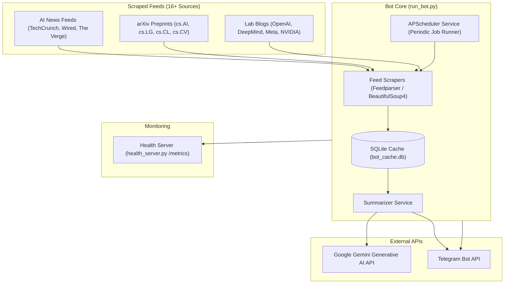

# AI Daily Telegram Bot

<p align="center">
  
</p>

<p align="center">
  
  
  
  
  
  <a href="./LICENSE"></a>
</p>

> An automated AI and machine learning news curation bot for Telegram. It scrapes 16+ industry feeds, arXiv categories, and research blogs, summarizes articles via Google Gemini, caches updates in SQLite to eliminate duplicate notifications, and broadcasts periodic digests on a configurable schedule.

**Status:** Prototype portfolio project. Built to demonstrate asynchronous bot engineering, multi-source feed scraping, deduplicated local caching, and LLM text summarization.

<!-- TODO[L2-01]: Capture a screenshot of the Telegram bot responding to /summary and /latest; save to docs/assets/bot-chat.png (owner: Maintainer) -->

<p align="center">
  <a href="#what-it-does">What It Does</a> •
  <a href="#quick-facts">Quick Facts</a> •
  <a href="#bot-commands">Bot Commands</a> •
  <a href="#architecture">Architecture</a> •
  <a href="#tech-stack">Tech Stack</a> •
  <a href="#quick-start">Quick Start</a> •
  <a href="#configuration">Configuration</a> •
  <a href="#testing">Testing</a> •
  <a href="./LICENSE">License</a>
</p>

---

## What It Does

AI Daily Telegram Bot acts as an automated intelligence assistant for machine learning practitioners and researchers:

1. **Multi-Source Ingestion:** Continuously scrapes RSS feeds and HTML from 16+ curated platforms, spanning industry publications (TechCrunch, VentureBeat, MIT Tech Review, The Verge, Wired), research preprint feeds (arXiv `cs.AI`, `cs.LG`, `cs.CL`, `cs.CV`), and engineering blogs (OpenAI, DeepMind, Meta AI, Google Research, Hugging Face, NVIDIA).
2. **Deduplication & Cache Management:** Stores article hashes in a local SQLite database (`bot_cache.db`), ensuring subscribers never receive duplicate news notifications across polling cycles.
3. **AI-Powered Summarization:** Leverages the Google Gemini API to distill long-form research papers and articles into concise, bulleted key takeaways.
4. **Scheduled Automated Delivery:** Runs background cron jobs via APScheduler to broadcast digests to designated Telegram channels or private chats on a configurable 2-hour or daily cadence.
5. **Interactive Q&A & Comparison:** Handles interactive user commands in Telegram chat, including model comparisons and ad-hoc category queries.
6. **Observability & Health Checks:** Includes a standalone FastAPI health server (`health_server.py`) exposing Prometheus metrics (`/metrics`), liveness (`/health/live`), and readiness checks (`/health/ready`).

---

## Quick Facts

| Dimension | Specification | Evidence Source |
|:---|:---|:---|
| Project Type | Telegram Bot / Automated Information Aggregator | `pyproject.toml`, `requirements.txt` |
| Primary Language | Python (>= 3.11) | `pyproject.toml:8`, `runtime.txt` |
| Primary Frameworks | `python-telegram-bot` (>= 22.8), FastAPI (observability) | `requirements.txt:1,14` |
| AI Summarization Model | Google Gemini (`google-generativeai>=0.8.6`) | `requirements.txt:10`, `config/config.py` |
| Scheduling Engine | APScheduler (>= 3.11.3) | `requirements.txt:9`, `services/scheduler.py` |
| Persistence & Cache | SQLite (`bot_cache.db`) | `utils/cache_manager.py` |
| Test Suite | 143 collected tests across unit, scraper, and bot logic suites | `tests/` directory (`pytest`) |
| License | MIT License | `LICENSE` file |

---

## Bot Commands

The bot supports the following commands inside Telegram:

| Command | Description | Code Implementation |
|:---|:---|:---|
| `/start` | Welcome message and introduction to available features | `run_bot.py` |
| `/help` | Detailed command list and usage guidance | `run_bot.py` |
| `/latest` | Fetch the 5 most recent AI news stories across all categories | `run_bot.py` |
| `/news` | View top headlines from mainstream AI news outlets | `run_bot.py` |
| `/arxiv` | View recent research papers across computer science preprint feeds | `run_bot.py` |
| `/blogs` | Read technical updates from AI labs (OpenAI, DeepMind, Google) | `run_bot.py` |
| `/summary` | Generate an AI summary of today's top stories via Gemini | `services/summarizer.py` |
| `/compare` | Side-by-side comparison of frontier LLM specifications | `services/model_comparison.py` |
| `/stats` | View cache statistics, scraped article counts, and uptime | `run_bot.py` |

---

## Architecture



*Data flow summary: Scrapers poll external RSS and HTML feeds periodically. Unseen articles are stored in SQLite. The scheduler triggers the summarization pipeline, which calls Gemini to create structured digests and posts them to Telegram via the Telegram Bot API.*

---

## Tech Stack

### Backend & Scraping
- **Runtime:** Python 3.11+
- **Telegram Bot Framework:** `python-telegram-bot` (v22.8+) with `asyncio`
- **RSS & HTML Parsing:** `feedparser>=6.0.14`, `beautifulsoup4>=4.15.0`, `lxml>=6.1.3`
- **HTTP Clients:** `httpx>=0.28.1`, `requests>=2.34.2`
- **Task Scheduling:** `apscheduler>=3.11.3`
- **Persistence:** SQLite (`bot_cache.db`) for hash-based deduplication

### Generative AI
- **LLM Gateway:** `google-generativeai>=0.8.6` (Google Gemini API)

### Observability & Infrastructure
- **Metrics & Health:** FastAPI (`fastapi>=0.143.0`), `uvicorn>=0.54.0`, `prometheus-client>=0.26.0`
- **Containerization:** `Dockerfile`, Docker Compose (`docker-compose.yml`, `docker-compose.dev.yml`)
- **PaaS Deployment Configs:** `Procfile` (Heroku/Railway), `render.yaml` (Render), `railway.json`

---

## Prerequisites

Before running the bot, ensure you have:
- **Python:** Version 3.11 or newer (`python --version`)
- **Telegram Bot Token:** Created via [@BotFather](https://t.me/BotFather) on Telegram
- **Telegram Chat ID:** Your personal user ID or target broadcast channel ID (use `python get_chat_id.py` to discover it)
- **Gemini API Key:** Obtained from [Google AI Studio](https://aistudio.google.com/)

---

## Quick Start

### 1. Clone the repository
```bash
git clone https://github.com/themanoj-025/SimAI-Telegram-Bot.git
cd SimAI-Telegram-Bot
```

### 2. Configure Python environment

**On Windows (PowerShell):**
```powershell
python -m venv .venv
.\.venv\Scripts\Activate.ps1
pip install -r requirements.txt
pip install -e .
```

**On Linux / macOS (Bash):**
```bash
python3 -m venv .venv
source .venv/bin/activate
pip install -r requirements.txt
pip install -e .
```

### 3. Set environment configuration
```bash
cp .env.example .env
```
*(On Windows cmd: `copy .env.example .env`). Populate `TELEGRAM_BOT_TOKEN`, `TELEGRAM_CHAT_ID`, and `GEMINI_API_KEY`.*

### 4. Run the Telegram Bot
```bash
python run_bot.py
```

Expected terminal output:
```text
[INFO] Starting AI Daily Telegram Bot...
[INFO] Database initialized: bot_cache.db
[INFO] Scheduler started: 2-hour refresh interval
[INFO] Bot polling started. Press Ctrl+C to stop.
```

### 5. Run the Health & Metrics Server (Optional, separate terminal)
```bash
python health_server.py
```
Access Prometheus metrics on `http://localhost:8080/metrics` and liveness checks on `http://localhost:8080/health/live`.

---

## Docker Deployment

To launch the bot inside an isolated container:

```bash
# 1. Prepare environment
cp .env.example .env

# 2. Build and start containers
docker compose up --build -d

# 3. View live bot logs
docker compose logs -f bot
```

To stop the container:
```bash
docker compose down
```

---

## Configuration

Settings are defined in [`config/config.py`](config/config.py) and loaded from `.env`:

| Variable | Required | Default | Description | Secret |
|:---|:---:|:---|:---|:---:|
| `TELEGRAM_BOT_TOKEN` | **Yes** | None | Authentication token issued by @BotFather | **Yes** |
| `GEMINI_API_KEY` | **Yes** | None | Google AI Studio API key for article summarization | **Yes** |
| `TELEGRAM_CHAT_ID` | No | None | Target chat or channel ID for scheduled auto-broadcasts | No |
| `DATABASE_PATH` | No | `bot_cache.db` | Local SQLite database file for deduplication cache | No |
| `LOG_FILE` | No | `ai_daily_bot.log` | File path for persistent execution logs | No |

---

## Project Structure

```text
AI-Telegram-News-Bot/
├── config/                        # Configuration loader and RSS feed definitions
│   └── config.py                  # Environment parsing and feed catalog
├── docs/                          # Architecture guides and reference documentation
├── scrapers/                      # Modular news and feed extractors
│   ├── arxiv_scraper.py           # Computer science preprint fetcher
│   ├── async_base_scraper.py      # Asynchronous base scraper class
│   └── news_scraper.py            # RSS parser and HTML content sanitizer
├── services/                      # Application service layers
│   ├── model_comparison.py        # Model benchmarking comparison logic
│   ├── report_generator.py        # Markdown digest formatter
│   ├── scheduler.py               # APScheduler background task manager
│   └── summarizer.py              # Gemini generative AI summarization client
├── tests/                         # Automated test suite (143 test cases)
├── utils/                         # Shared utilities (cache manager, logger, telegram helpers)
│   ├── cache_manager.py           # SQLite article deduplication engine
│   └── telegram_utils.py          # Message length guard and split delivery
├── .env.example                   # Annotated environment variable template
├── Dockerfile                     # Multi-stage production container build
├── docker-compose.yml             # Docker composition file
├── health_server.py               # Standalone FastAPI health and metrics server
├── pyproject.toml                 # Packaging metadata and lint tool configurations
├── requirements.txt               # Pinned package dependencies
└── run_bot.py                     # Primary bot execution entrypoint
```

---

## Testing

The test suite validates RSS parsing, SQLite cache expiration, message chunking, and mock bot command responses:

```bash
# Run the complete test suite
pytest tests/ -v

# Run unit tests only
pytest tests/ -m "unit" -v

# Run with coverage report
pytest tests/ --cov=. --cov-report=term-missing

# Run documentation anchor, link, and fence validation
python .github/scripts/lint_readme.py
```

---

## Limitations and Threat Model

- **Third-Party RSS Availability:** News delivery depends on external feed stability. Scrapers implement timeout and circuit-breaker handling to gracefully bypass unreachable feeds.
- **Telegram Message Limits:** Telegram enforces a 4,096-character limit per message. The bot includes an automated chunking utility (`utils/telegram_utils.py`) to split long digests safely without breaking words.
- **API Rate Limits:** Google Gemini and Telegram Bot APIs enforce query rate limits. The bot applies client-side throttling to maintain reliable execution.

---

## Contributing

Contributions and feed suggestions are welcome! Please review [CONTRIBUTING.md](./CONTRIBUTING.md) before submitting pull requests.

1. Fork the repository.
2. Create a feature branch (`git checkout -b feature/add-new-feed`).
3. Commit your changes following Conventional Commits (`git commit -m 'feat: add HuggingFace papers feed'`).
4. Ensure all tests and linters pass (`pytest tests/` and `python .github/scripts/lint_readme.py`).
5. Open a Pull Request.

---

## Security

Please report vulnerabilities confidentially according to [SECURITY.md](./SECURITY.md). Do not submit public issues for suspected security exploits.

---

## License

This project is licensed under the terms of the MIT License. See [LICENSE](./LICENSE) for details.
