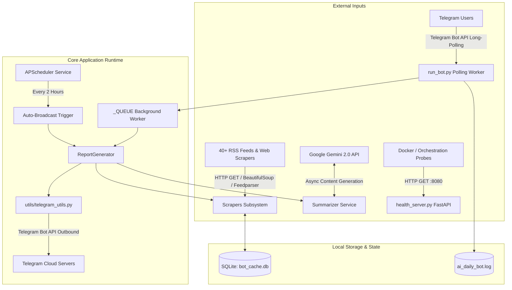

# Phase 1: Reconnaissance and Attack-Surface Mapping

**Target**: `AI-Telegram-News-Bot`
**Date**: 2026-10-15
**Auditor**: Security Audit Agent (Master Ultra Prompt v2.0)

---

## 1.1 Architecture Map

The application is an asynchronous AI-powered intelligence bot for Telegram that periodically aggregates, parses, deduplicates, summarizes, and broadcasts news, research, models, and tools across the AI landscape. It also exposes a background FastAPI HTTP server for container orchestration health checks and metrics.

### Component Breakdown
| Component | Implementation File(s) | Role & Network Exposure | Auth / Protection |
| :--- | :--- | :--- | :--- |
| **Telegram Polling Worker** | `run_bot.py` | Outbound long-polling connection to Telegram Bot API. No inbound listening port. | Telegram Bot Token (`TELEGRAM_BOT_TOKEN`). |
| **Health & Metrics Server** | `health_server.py` | Inbound HTTP service on `0.0.0.0:8080` (FastAPI + Uvicorn) in a daemon thread. Exposes `/health`, `/health/ready`, `/metrics`, `/docs`. | IP-restricted to localhost/container network, CORS limited to localhost, SlowAPI rate limiter. |
| **Scheduler Service** | `services/scheduler.py` | Background APScheduler triggering broadcasts every 2 hours. | Internal trigger; controlled by `TELEGRAM_CHAT_ID`. |
| **Report Generator** | `services/report_generator.py` | Orchestrates scraping, formatting, and generation of reports across 15 categories. | Internal dispatch. |
| **Scraper Subsystem** | `scrapers/*.py` | Asynchronous HTTP clients (`httpx`) fetching RSS/HTML feeds. | Timeout and circuit-breaker protection; fallback data on failure. |
| **Summarizer Service** | `services/summarizer.py` | Calls Google Gemini 2.0 API (`google-generativeai`) to summarize scraped headlines. | `GEMINI_API_KEY`. Falls back to simple headlines if key absent. |
| **Local Cache & Seen Store** | `utils/cache_manager.py` | SQLite database (`bot_cache.db`) with tables `cache` and `seen_items`. | File-system access; parameterized SQL. |
| **Telegram Dispatcher** | `utils/telegram_utils.py` | Splits and sends Markdown messages to Telegram with rate limiting and retry fallbacks. | Telegram API rate limit handling. |

---

## 1.2 Entry-Point Inventory

Untrusted data enters the application through three primary boundaries:
1. Inbound Telegram messages and commands from arbitrary Telegram users.
2. Inbound HTTP requests received by the FastAPI health server (`:8080`).
3. External web content and RSS feed payloads scraped from third-party websites.

### Telegram Interface Entry Points
| Command / Trigger | Handler Function | Auth Required | Input Schema / Args | Rate Limit |
| :--- | :--- | :--- | :--- | :--- |
| `/start`, `/help` | `start_command`, `help_command` | None (Public) | None | Per-chat broadcast cooldown only |
| `/daily` | `daily_command` | None (Public) | None | Queued work + 300s broadcast cooldown |
| `/summary` | `summary_command` | None (Public) | None | Queued work |
| `/compare <args>` | `compare_command` | None (Public) | Free-text string (`args`) | Free-text lookup in dictionary |
| `/roadmap <role>` | `roadmap_command` | None (Public) | Free-text string (`role`) | Free-text lookup in dictionary |
| `/leaderboard <term>` | `leaderboard_command` | None (Public) | Free-text string (`filter_term`) | Filter substring match |
| 12 Category Commands (`/news`, `/tools`, `/jobs`, `/startups`, `/models`, `/trending`, `/learn`, `/papers`, `/blogs`, `/india`, `/youtube`, `/twitter`) | `create_handler(category)` | None (Public) | None | Queued background task |
| Free-text Message | `handle_message` | None (Public) | Arbitrary string | Substring dispatch to commands |

### HTTP Health Server Entry Points (`0.0.0.0:8080`)
| Route | Method | Auth Required | Input Schema | Rate Limit | Role / Purpose |
| :--- | :--- | :--- | :--- | :--- | :--- |
| `/health` | GET | None | None | None | Liveness probe (200 OK) |
| `/health/ready` | GET | None | None | None | Readiness probe (200 / 503) |
| `/metrics` | GET | None | None | None | Prometheus metrics plain text |
| `/` | GET | None | None | None | Service info & links |
| `/docs`, `/redoc` | GET | None | None | None | Swagger / ReDoc UI |
| `/openapi.json` | GET | None | None | None | OpenAPI JSON schema |

### External Web & Feed Ingestion Entry Points
| Feed Category | Source URLs | Ingestion Method | Untrusted Fields Extracted |
| :--- | :--- | :--- | :--- |
| RSS Feeds (News, Blogs, Arxiv, Jobs, Tools, etc.) | ~35 hardcoded URLs in `config.py` | `httpx.get` + `feedparser.parse` | `entry.title`, `entry.link`, `entry.published`, `feed.title` |
| Web Scraping (India AI, GitHub, Twitter RSSHub) | Hardcoded URLs in `scrapers/*.py` | `httpx.get` + `BeautifulSoup` | Extracted heading text, URLs, repository descriptions |
| Gemini API Output | Google Generative AI API | Async RPC | Model output text |

---

## 1.3 Sink Inventory (Dangerous Operations)

| Sink Type | File & Line Reference | Mechanism | Safety Assessment |
| :--- | :--- | :--- | :--- |
| **SQL Database Queries** | `utils/cache_manager.py:24-42, 53, 74, 87, 89, 101, 114, 126` | `sqlite3.connect()`, `cursor.execute()` | **SAFE**: All queries use parameterized `?` placeholders. No dynamic SQL interpolation. |
| **Shell / Process Execution** | None in core application. `Dockerfile:79-83` (HEALTHCHECK) | `python -c "..."` in container healthcheck | **SAFE**: No `subprocess`, `os.system`, or shell invocations based on runtime user input. |
| **Dynamic Code Execution** | None (`eval`, `exec`, `__import__` absent) | N/A | **SAFE**: Not present in source code. |
| **Outbound HTTP Requests** | `scrapers/async_base_scraper.py:27`, `scrapers/indian_news_scraper.py:30`, `get_chat_id.py:18` | `httpx.AsyncClient().get()`, `requests.get()` | **SAFE**: Targets are restricted to predefined RSS/API lists in `Config`. No user-supplied arbitrary URL fetching. |
| **LLM Prompt Construction** | `services/summarizer.py:44-50` | String f-string concatenation: `f"{content}"` | **VULNERABLE TO INDIRECT INJECTION**: Scraped article titles are inserted directly into prompt text without structure or boundary delimiters. |
| **Telegram Message Formatting** | `utils/telegram_utils.py:59, 114` | `reply_text(..., parse_mode="Markdown")` | **PARTIAL / RISK**: Markdown syntax injection can cause Telegram parse failures (though caught by try/except fallback). |
| **File System Write** | `utils/cache_manager.py:16`, `utils/logger.py:40` | SQLite DB file and log file | **SAFE**: Fixed filenames (`bot_cache.db`, `ai_daily_bot.log`) or configurable via environment variable. |

---

## 1.4 Asset and Data Classification

| Asset | Classification | Storage Location | Retention / Scope | Encryption at Rest |
| :--- | :--- | :--- | :--- | :--- |
| `TELEGRAM_BOT_TOKEN` | **Restricted / Secret** | Environment variable (`.env` / container env) | Process memory only | Cloud provider / host dependent |
| `GEMINI_API_KEY` | **Restricted / Secret** | Environment variable (`.env` / container env) | Process memory only | Cloud provider / host dependent |
| `TELEGRAM_CHAT_ID` | **Confidential** | Environment variable (`.env`) | Process memory only | Host dependent |
| Inbound User Queries | **Internal / Ephemeral** | Transient memory | Dropped after reply | N/A |
| Scraped Articles & Summaries | **Public** | SQLite (`bot_cache.db`) | 6-hour cache expiry | No (Public data) |
| System Logs | **Internal** | Local file `ai_daily_bot.log` | Rotated by size (10 MB, 5 backups) | No |

---

## 1.5 Identity and Trust Model

1. **Anonymous Telegram Users**: Any Telegram user who discovers the bot can send commands. The bot executes commands without authentication. There is no user identity check or authorization gating for interactive query commands (`/daily`, `/summary`, `/compare`, etc.).
2. **Channel / Subscriber Audience**: The scheduled 2-hour broadcast is restricted to `Config.TELEGRAM_CHAT_ID`. Individual interactive commands reply to the requesting `update.effective_chat.id`.
3. **Local / Container Health Probes**: Container orchestration systems (Kubernetes, Docker) access the HTTP server on port 8080. No credentials required, restricted to read-only diagnostic info.
4. **Third-Party Providers**:
   - Telegram Bot API: Trusted for messaging and polling.
   - Google Gemini: Trusted for summarization.
   - External RSS / News Sources: Untrusted data providers (potential content spoofing, defacement, or prompt injection).

---

## 1.6 Secrets and Configuration Map

| Variable Name | Required | Default | Sensitivity | Where Read | Exposed to Client? |
| :--- | :--- | :--- | :--- | :--- | :--- |
| `TELEGRAM_BOT_TOKEN` | Yes | None | **High (Secret)** | `config/config.py:11`, `run_bot.py:335` | No (Server-side only) |
| `TELEGRAM_CHAT_ID` | No | None | **Medium (Confidential)** | `config/config.py:12`, `run_bot.py:417` | No |
| `GEMINI_API_KEY` | No | None | **High (Secret)** | `config/config.py:13`, `services/summarizer.py:25` | No |
| `DATABASE_PATH` | No | `bot_cache.db` | **Low (Internal)** | `utils/cache_manager.py:16` | No |
| `LOG_FILE` | No | `ai_daily_bot.log` | **Low (Internal)** | `config/config.py:192` | No |
| `LOG_LEVEL` | No | `INFO` | **Low (Internal)** | `config/config.py:191` | No |

---

## 1.7 Dependency and Supply-Chain Inventory

- **Package Management**: `pyproject.toml`, `requirements.txt`, `requirements.lock`, `uv.lock`.
- **Ecosystem**: Python (3.11 - 3.14 compatible).
- **Direct Dependencies**:
  - `python-telegram-bot>=21.0` (Bot polling & Telegram API)
  - `fastapi>=0.110.0`, `uvicorn>=0.28.0` (Health HTTP service)
  - `slowapi>=0.1.9` (Rate limiting)
  - `httpx>=0.27.0` (Async HTTP scraping)
  - `beautifulsoup4>=4.12.0`, `feedparser>=6.0.10` (Parsing)
  - `google-generativeai>=0.8.0` (LLM summarization)
  - `apscheduler>=3.10.4` (Job scheduling)
  - `python-dotenv>=1.0.0` (Environment config)
- **Lockfile Hygiene**: `requirements.lock` and `uv.lock` are tracked in git; CI has `lockfile-drift.yml` to prevent unpinned drift.
- **CI Workflows**: GitHub Actions workflow files present for CodeQL (`codeql.yml`), Gitleaks (`gitleaks.yml`), SBOM generation (`sbom.yml`), and dependency security audit (`security-audit.yml`).
